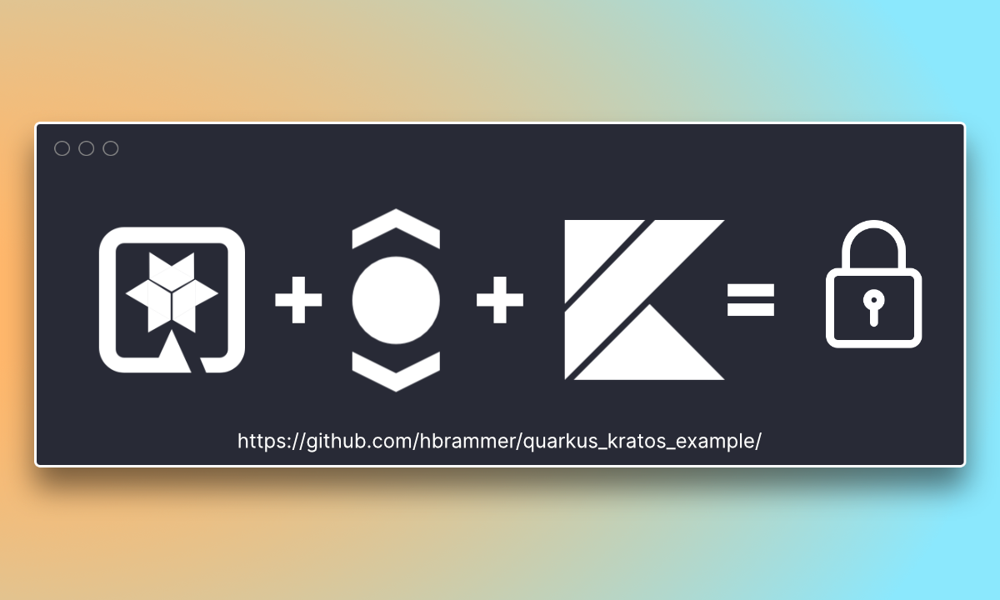

# Secure a Kotlin Quarkus app using Ory Kratos



This repo demonstrates how you can use self-hosted Ory Kratos to secure a Kotlin
Quarkus application. This app is not for production use and serves as an example
of integration.

Written by [Hauke Brammer](https://github.com/hbrammer), who explains it in a
tutorial on his blog:
[hauke.me](https://hauke.me/writing/2021-03-building-a-quarkus-application-with-ory-kratos/).
The tutorial was written for Kratos v0.5, so some details differ from the code
here. Kratos now describes a form as `ui.nodes` rather than grouping fields
under `methods`, registers in two steps by default, and logs out through
`/self-service/logout/browser`.

## Overview

- Creates a simple web page with Quarkus, Kotlin and Qute.
- Secures the `/recipe` page with Ory Kratos.
- Renders the Kratos login and registration forms itself.
- Builds a custom REST client to interact with Kratos.

The login and registration pages fetch their flow from Kratos on the server, so
they pass the browser's `Cookie` header on: Kratos checks the flow's CSRF cookie
and answers 403 without it. The forms render every input node Kratos sends,
including the hidden ones and the submit buttons, which is what makes the
two-step registration work.

## Run locally with Docker

From `kratos-kotlin-quarkus`, run:

```bash
docker compose up --build
```

Open http://127.0.0.1:8080, sign up, and open the secret recipe. Use `127.0.0.1`
consistently so the app and Kratos share cookies. Add `--profile ui` to start
Mailpit on http://127.0.0.1:8025 and read the verification emails.

## Develop with Maven

Use Java 21 and Docker for the local Kratos services. From
`kratos-kotlin-quarkus`, run:

```bash
docker compose up -d kratos
./mvnw quarkus:dev
```

Open http://127.0.0.1:8080.

### Run tests

```bash
make test
```

This brings the stack up and drives the app the way a browser would, with
`curl`: it signs up through the app's two-step registration form, opens
`/recipe`, logs out, logs in through the app's login form, and checks that a
missing or unknown flow sends the browser back to Kratos for a new one. It
needs no credentials and no browser.

## Contribute

Feel free to
[open a discussion](https://github.com/ory/awesome-ory/discussions/new) to provide
feedback or talk about ideas, or
[open an issue](https://github.com/ory/awesome-ory/issues/new) if you want to add
your example to the repository or encounter a bug. You can contribute to Ory in
many ways, see the
[Ory Contributing Guidelines](https://www.ory.com/docs/ecosystem/contributing)
for more information.
